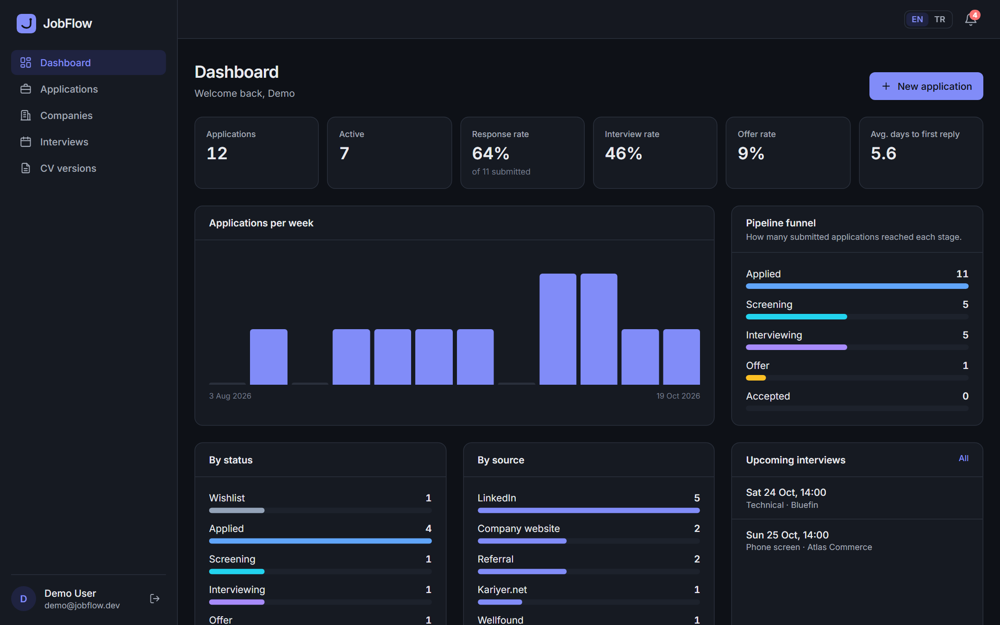
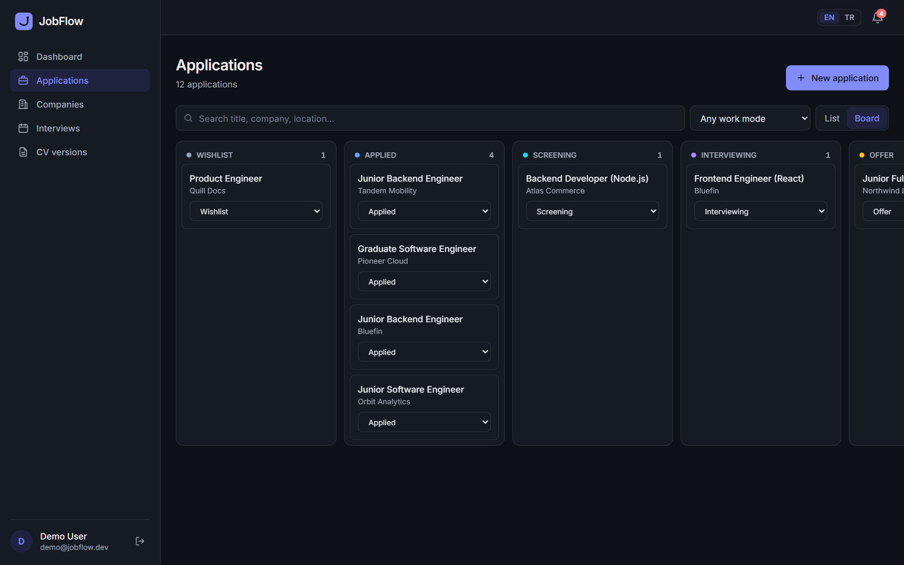
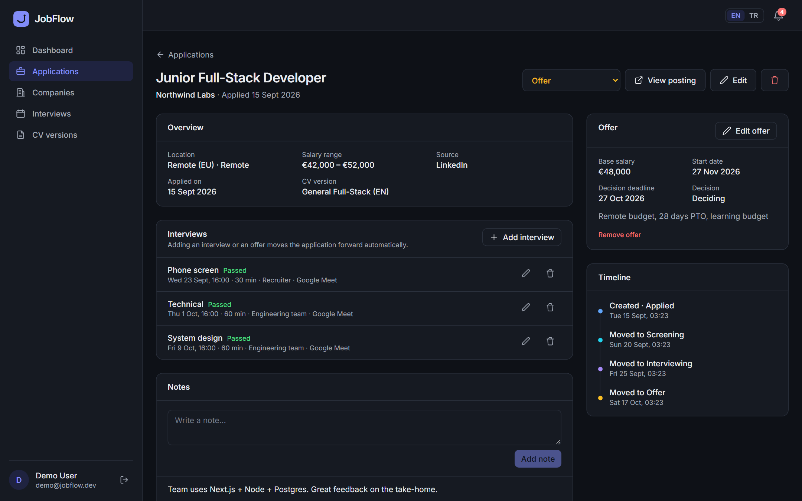
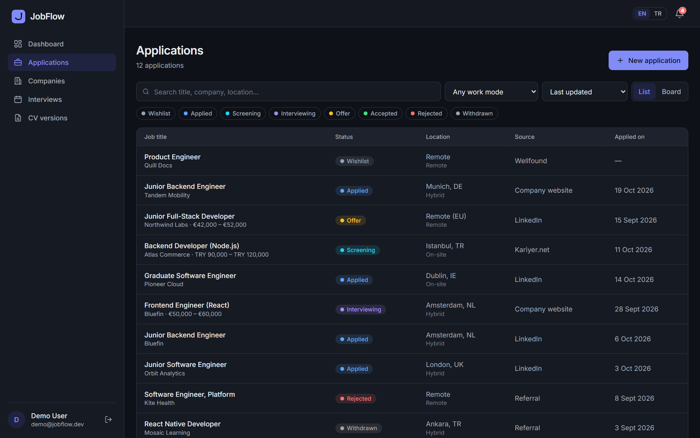
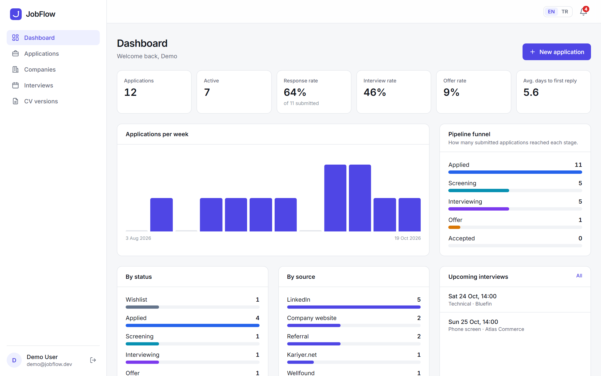
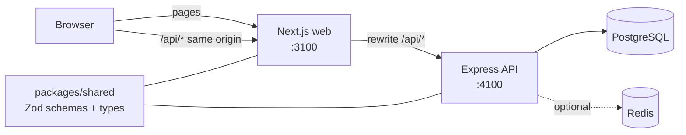

# JobFlow

**Track every job application, interview and offer in one place, and see what is working.**

JobFlow is a full-stack job search tracker: a Node.js REST API with PostgreSQL, and a Next.js web app. It keeps the whole pipeline in one place, from wishlist to accepted offer, along with the history of every status change, interview rounds, offers, notes and which CV version went where. The analytics show your response, interview and offer rates and which sources work best.



<table>
  <tr>
    <td></td>
    <td></td>
  </tr>
  <tr>
    <td></td>
    <td></td>
  </tr>
</table>

## Why JobFlow?

Spreadsheets stop being useful once a job search has dozens of applications, several interview rounds and more than one CV. Full applicant tracking systems go the other way and are built for recruiters, not candidates. JobFlow sits in between: the pipeline, the interview calendar and the numbers on one screen, with the boring parts (moving an application forward when an interview or offer is logged) done automatically.

## Features

- **Authentication**: email and password, httpOnly cookies, short-lived JWT access tokens, rotating refresh tokens with reuse detection.
- **Applications**: list and board (drag and drop) views, full-text search across title, company, location and source, status and work-mode filters, sorting, pagination. Filters live in the URL.
- **Status history**: every change is recorded and shown as a timeline. Adding an interview or an offer moves the application forward automatically, but never backwards or out of a closed state.
- **Interviews**: type, time, duration, interviewer, link, notes and outcome; a cross-application "upcoming / past" view.
- **Offers**: salary, bonus, equity, benefits, start date, decision deadline. Accepting an offer marks the application as accepted.
- **Companies, notes and CV versions**: companies are created on the fly from the application form; each application records the CV version used.
- **Analytics**: response, interview and offer rates, pipeline funnel, applications per week (12 weeks), breakdown by status and by source, average days to first reply. Cached per user and invalidated on every write.
- **Reminders**: interviews in the next 48 hours, offer deadlines within a week, and applications with no reply after 14 days.
- **English and Turkish interface**, light and dark themes, responsive down to phone width.

## Tech stack

| Layer    | Tools                                                                                                    |
| -------- | -------------------------------------------------------------------------------------------------------- |
| Web      | Next.js 16 (App Router), React 19, TypeScript, Tailwind CSS 4, TanStack Query, React Hook Form           |
| API      | Node.js, Express 5, TypeScript, Zod, Prisma 7 (driver adapter), pino                                     |
| Data     | PostgreSQL, Redis (optional: rate limits and analytics cache)                                            |
| Shared   | `@jobflow/shared`: Zod schemas, enums and response types used by both apps                               |
| Quality  | Vitest + Supertest (API integration tests on a real database), Playwright (end-to-end), ESLint, Prettier |
| Delivery | Docker (multi-stage images), Docker Compose, GitHub Actions                                              |

## Architecture



```
jobflow/
├── apps/
│   ├── api/                 Express REST API
│   │   ├── prisma/          schema, migrations, demo seed
│   │   ├── src/modules/     auth, applications, interviews, notes, companies, cv-versions, analytics
│   │   ├── src/middleware/  auth, validation, rate limiting, errors
│   │   └── test/            integration tests (Vitest + Supertest)
│   └── web/                 Next.js app
│       ├── src/app/         routes: (auth) login/register, (app) dashboard, applications, …
│       ├── src/components/  UI kit, forms, charts, app shell
│       └── e2e/             Playwright tests
├── packages/shared/         validation schemas and API types shared by both apps
├── scripts/dev-db.mjs       PostgreSQL without Docker, for local development
├── docker-compose.yml
└── .github/workflows/ci.yml
```

### Design decisions

- **One origin for the browser.** Next.js forwards `/api/*` to the API, so auth cookies are first-party and there is no CORS setup in the normal path.
- **CSRF.** Cookies are `SameSite=Lax`, and the API rejects any write whose body is not `application/json`. A cross-site page cannot send a JSON request without a CORS preflight, which the API never approves for other origins.
- **Refresh token rotation.** Refresh tokens are random, stored only as hashes, and replaced on every use. If an already used token shows up again, the whole login family is revoked. Two tabs refreshing at the same moment cannot both win. This follows the refresh token rotation guidance in [RFC 9700 §4.14.2](https://www.rfc-editor.org/rfc/rfc9700#section-4.14.2).
- **Ownership checks in every query.** Every read and write is scoped by `userId` in the `where` clause, so another user's ID returns 404 and leaks nothing. Tests cover this explicitly.
- **One source of validation.** The same Zod schemas validate API input and describe the types the web app uses. Field errors come back as `{ path, message }` and are shown next to the right input.
- **Analytics from history.** The funnel counts the furthest stage an application ever reached (from `StatusChange` rows), so an application rejected after an interview still counts as "reached interview".
- **Per-user analytics cache.** The overview is cached under one key per user for 60 seconds and deleted after every write to that user's applications, interviews or offers, so numbers are never stale after a change.
- **No WebSockets.** Each account has a single user, so there is nobody else to push changes to. TanStack Query refreshes affected lists after every write, board moves update the cache optimistically and roll back on error, and notifications are polled every 5 minutes.
- **Redis is optional.** Rate limiting and caching go through a small key-value interface backed by Redis when `REDIS_URL` is set, or memory otherwise.

## Getting started

Requirements: Node.js 22 or newer. Docker is optional.

```bash
npm install
cp apps/api/.env.example apps/api/.env      # then set the two JWT secrets
cp apps/web/.env.example apps/web/.env.local
```

**1. Start PostgreSQL.** Pick one:

```bash
npm run db:start                      # real PostgreSQL via embedded-postgres, no Docker (port 5433)
docker compose up -d postgres redis   # or with Docker (also port 5433)
```

**2. Create the schema and the demo data** (in a second terminal):

```bash
npm run db:migrate
npm run db:seed
```

**3. Run the API and the web app:**

```bash
npm run dev
```

Open http://localhost:3100 and sign in with **demo@whoischat.dev / demo1234**, or create an account.

### Run everything in Docker

```bash
docker compose up --build
```

Then open http://localhost:3100. Migrations run when the API container starts. For demo data, run `npm run db:seed` from your machine: the database is published on port 5433, which is what `apps/api/.env.example` points to.

## Scripts

| Command                                  | What it does                                                     |
| ---------------------------------------- | ---------------------------------------------------------------- |
| `npm run dev`                            | API (watch mode) and web app together                            |
| `npm run build` / `npm start`            | Production build / start both apps                               |
| `npm run db:start`                       | Local PostgreSQL without Docker                                  |
| `npm run db:migrate` / `npm run db:seed` | Apply migrations / load demo data                                |
| `npm test`                               | API integration tests (uses `TEST_DATABASE_URL`, which is wiped) |
| `npm run e2e`                            | Playwright end-to-end tests                                      |
| `npm run lint` / `npm run typecheck`     | ESLint / TypeScript across the monorepo                          |

## API

All routes are under `/api`. Everything except `/auth/*` requires a session. Errors look like `{ "error": { "code", "message", "details?" } }`.

| Method                   | Path                               | Description                                                                                 |
| ------------------------ | ---------------------------------- | ------------------------------------------------------------------------------------------- |
| POST                     | `/auth/register`, `/auth/login`    | Create an account / sign in (sets cookies)                                                  |
| POST                     | `/auth/refresh`, `/auth/logout`    | Rotate the refresh token / sign out                                                         |
| GET                      | `/auth/me`                         | Current user                                                                                |
| GET, POST                | `/applications`                    | List (`q`, `status`, `workMode`, `companyId`, `sort`, `order`, `page`, `pageSize`) / create |
| GET, PATCH, DELETE       | `/applications/:id`                | Detail with interviews, offer, notes and history / update / delete                          |
| PATCH                    | `/applications/:id/status`         | Change status (recorded in history)                                                         |
| POST                     | `/applications/:id/interviews`     | Add an interview                                                                            |
| PUT, DELETE              | `/applications/:id/offer`          | Create or update / remove the offer                                                         |
| POST                     | `/applications/:id/notes`          | Add a note                                                                                  |
| GET                      | `/interviews?range=upcoming\|past` | Interviews across all applications                                                          |
| PATCH, DELETE            | `/interviews/:id`, `/notes/:id`    | Update / delete                                                                             |
| GET, POST, PATCH, DELETE | `/companies`, `/cv-versions`       | CRUD                                                                                        |
| GET                      | `/analytics/overview`              | Rates, funnel, weekly activity, sources                                                     |
| GET                      | `/notifications`                   | Reminders                                                                                   |
| GET                      | `/health` (no `/api` prefix)       | Liveness and database check                                                                 |

## Testing

- **API**: 24 integration tests run against a real PostgreSQL database. They cover auth (rotation, reuse detection, logout, CSRF guard), validation, search, filters, pagination, status history, automatic status moves, isolation between users, and the analytics maths.
- **End to end**: Playwright covers the signed-out redirect, form validation, the full flow from creating an application to an offer, and switching language.
- **CI** runs lint, typecheck, unit/integration tests, production build, end-to-end tests, and builds both Docker images on every push and pull request.

## Known limitations

- **Offset pagination.** The application list uses `page`/`pageSize`. It is simple and keeps filters in the URL, and is fine at personal-tracker scale; a cursor would be the next step for very large lists.
- **Access tokens live until they expire.** Logout revokes the refresh token right away, but an already issued access token stays valid for up to 15 minutes.
- **In-memory fallback is per process.** Without `REDIS_URL`, rate limits and the analytics cache are not shared between API instances.
- **No currency conversion.** Salaries and offers keep their own currency; nothing converts between them.

## Roadmap

- Email reminders for interviews and offer deadlines
- CV file uploads
- Import applications from a job posting URL
- CSV export

## License

MIT © Batuhan Sarısoy
